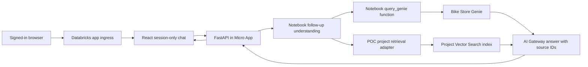

# Koantek Micro App POC

## Result — 16 November 2026

**Python + FastAPI + React can run on the Micro App runtime in this Koantek workspace.**
The deployed POC uses real Bike Store Genie, project-document retrieval and AI Gateway,
with the signed-in user's Databricks identity. An AppKit/Node rewrite was **not required**
for the deployment we tested.

**This is a session-only chat POC, not a complete migration of the production AIA app.**
The user approved this narrower scope after Lakebase attachment was rejected. Refreshing
the page clears its chat. Nothing is silently saved to local disk, localStorage, or the
old Lakebase chat database.

- [Open POC](https://aia-micro-poc-7474654589961519.aws.databricksapps.com)
- [Koantek app overview](https://dbc-f2d0e557-3d47.cloud.databricks.com/apps-v2/app/aia-micro-poc/overview)
- App: `aia-micro-poc`; App Space: `demo`; API-reported compute: `LIQUID`.
- Git branch: `poc/micro-app`; latest `main` changes merged through `34fbe2a`.
- Use Koantek Databricks sign-in. Access is authenticated; an anonymous API request returned HTTP 401.

## What the live POC does



`web.py` verifies the forwarded user token against the Koantek workspace on each API
request. It sends that same user token to the agent; there is no app-owner fallback.
The browser sends up to six prior messages as context. The notebook's `understand_query()`
resolves a follow-up to its subject. A new chat has an empty history.

The POC's `KoantekPocAgent` directly calls the Python export's `query_genie()`; it does
not run a notebook job or call a notebook URL. The POC has a separate project-record
adapter because Koantek's index has `pk` and `full_text`, while AIA's contract workflow
expects contract chunks and page metadata. This difference is about the available data,
not a Micro App requirement. The AIA `contract_assistant()` workflow remains the default
in the production entry point.

SQL is returned from Genie and shown through the existing React source renderer.
Project references use retrieved record IDs and a link to the real index. Project
records have no verified PDF/page locations, so the POC does not invent them. At most
five project records are retrieved; the answer explicitly discloses that the result is
not a complete inventory. Source IDs are checked against retrieved evidence; this does
not prove every generated sentence is correct.

The current release streams actual workflow milestones to React: queued, understanding,
searching, composing and preparing sources. The shared thinking component animates and
changes its wording while each stage runs. A Stop button aborts the browser request and
signals cancellation to the backend; an already-running provider call may still finish
before its worker is released. The answer arrives as one completed response, not token
by token. Only references marked as cited are shown in the collapsible **Sources** section;
there is no separate "Retrieved references" section.

## Verification

The first full live deployment passed these authenticated API checks. Timings are single
observations, not a benchmark or a cold-start SLA:

| Check | Result | App processing time |
|---|---|---:|
| Distinct bike-category count | 7; Genie selected; SQL source returned | 19.74 s |
| Project time period | Project retrieval selected; document source returned | 4.64 s |
| Project follow-up | Previous subject retained; document source returned | 5.46 s |
| Mixed bike + project question | Both tools; separate SQL and document references | 15.21 s |
| Auth and frontend assets | Verified identity; HTML/JS HTTP 200; anonymous HTTP 401 | — |

See `live-results.json` for sanitized metrics. Raw answers, retrieved text, SQL contents,
credentials and private chat history are not included in that file.

The final `session-v2` deployment (`01f1e1e917d0152dac11296b479ea1d8`) also passed a
live mixed-question check: HTTP 200, category count 7, both source types, no failed tools
and an explicit project-retrieval limit. App processing took 14.05 seconds. Sanitized
evidence is in `final-verification.json`.

### Current release: session-v3

Deployment `01f1e246d81c1fb19b2918ec9a6dba99` succeeded and switched traffic on
17 November 2026 at 05:25 UTC (16 November in Pacific time). Source snapshot:
`/Workspace/Users/badal.tomar@koantek.com/aia-micro-poc/session-v3`.

The new live streaming tests all passed:

| Scenario | Verified result | App processing | Client wall time |
|---|---|---:|---:|
| Bike category count | 7, one cited Genie SQL source | 15.95 s | 18.06 s |
| Edward Jones period | Project retrieval, cited document record | 5.25 s | 7.60 s |
| Project follow-up | Previous subject retained, cited document record | 18.60 s | 20.74 s |
| Mixed bike/project question | Both tools, one SQL and five document sources | 13.82 s | 15.88 s |

All four delivered the five progress stages in order, before the final response. For
example, the mixed request delivered queued at 2.05 s, understanding at 2.11 s,
searching at 3.90 s, composing at 12.60 s and sources at 15.86 s. This verifies progress
was delivered incrementally through the deployed ingress, rather than buffered until
completion. Timings are single observations, not a performance benchmark.

Sanitized evidence is in `stream-results.json`. It also verifies authenticated identity,
anonymous API rejection (401), and successful React HTML/bundle delivery (200).

Additional checks:

- Minimal Python/FastAPI deployment succeeded; runtime reported Python 3.11.17.
- Runtime probe received a forwarded user token and injected app credentials (only
  presence booleans were inspected).
- The initial diagnostic probe streamed responses about one second apart; session-v3
  additionally verifies real chat workflow progress, as described above.
- The Micro App automatically entered `STOPPED / App scaled to zero` while idle. An
  authenticated request returned an HTTP 202 HTML startup page; a later request returned
  HTTP 200 without an explicit `apps start` command. Automatic wake-up is verified, but
  exact cold-start latency was not measured because requests were not continuously polled.
- 174 existing backend tests and 8 POC adapter tests passed; the POC TypeScript/Vite build passed.
- For session-v3, 39 targeted backend tests and all 31 frontend tests passed. These cover
  the new endpoint, streamed parsing, source metadata, latest notebook adapter and direct
  calls. POC TypeScript checking and Vite build also passed.
- A separate offline probe restarted the existing API in a new Python process and verified
  history, sources, feedback, bookmarks, notes, follow-up context and owner checks. It used
  synthetic identities and disposable SQLite. **That is not a live Lakebase or SSO test.**

The earlier browser visual QA attempt was stopped by Computer Use because it could not
confidently verify the Windows browser URL. In the current session, Chrome opened the
deployed app successfully but reached the Databricks sign-in page; UI visual validation
is awaiting user sign-in. API and asset checks above do not prove visual animation quality.
Two real users, load tests, MLflow ingestion and full production-workflow parity remain
unverified.

## Lakebase limitation observed here

The POC created an empty database `aia_micro_poc` under the existing Koantek project
`atlas-chat-badal`, branch `production`. It did not create a new compute endpoint, copy
history, create chat tables or modify the existing `databricks_postgres` tables.

The attempted attachment failed:

1. Legacy `apps update` was rejected for an app inside an App Space; the platform required
   `apps create-update` with a field mask.
2. The correct update API rejected the database resource:
   `Apps in space 'demo' cannot declare a resource of this type on the app. Allowed resource types: [].`
3. Creating a separate resource-bearing App Space was also rejected:
   `Space 'aia-micro-poc' has no principal to grant shared resources to, so resources and data cannot be configured for it.`

No direct grants, static secrets or alternate credentials were used to bypass this
restriction. This is evidence about **this workspace's present App Space capabilities**,
not a claim that Lakebase is universally unsupported by Micro Apps. Confirm the supported
resource setup with the workspace administrator/Databricks before migrating durable chat
history. Request payloads are retained here for that review.

The project search index was queryable but reported `ONLINE_PIPELINE_FAILED` for its last
refresh. Retrieval worked; data freshness was not established. That is a source-index
maintenance issue, separate from Micro App hosting.

## Advantages, disadvantages and required changes

| Area | Benefit | Trade-off / change for our app |
|---|---|---|
| Idle compute | Scale-to-zero was observed | Cold starts; memory and local files cannot be durable history |
| Existing stack | Python/FastAPI and the React build deployed successfully | Validate the full AIA workflow and resources before migration; this POC uses a different data adapter |
| Authentication | User-token forwarding and workspace verification work | App Space governs scopes; API access still depends on each user's data permissions |
| Governance | App Space provides a common access boundary | Resource setup is less independent; our Lakebase attachment is currently blocked |
| Capacity | Managed on-demand runtime | Documented maximum is one instance; our notebook worker limit is two concurrent calls, with no load/SLA proof |
| Network | Workspace calls worked | No general public internet egress; package installs use managed proxies; external integrations need separate validation |
| Operations | No VM/container management for us | Beta limitations, fewer diagnostics; HTTP access logs are unavailable |
| Cost | Idle runtime can stop consuming active compute | Current Beta pricing can change; model, Genie warehouse, search and Lakebase services must be budgeted separately |

The scaling, network and Beta limitations above follow the
[Databricks runtime documentation](https://docs.databricks.com/aws/en/dev-tools/databricks-apps/genie-app-builder).
Identity and shared-resource governance are described in
[App Spaces](https://docs.databricks.com/aws/en/dev-tools/databricks-apps/app-spaces).
AppKit offers a Node/React framework, but that does not imply our tested Python deployment
needed to use it: [AppKit architecture](https://developers.databricks.com/docs/appkit/v0/architecture).

If we later adopt AppKit, do not expose chat tables through its default generated CRUD.
The database plugin does not implement per-user row authorization; retain custom owner
checks: [Database plugin](https://developers.databricks.com/docs/appkit/v0/plugins/database).

For a full migration:

1. Resolve supported Lakebase resource attachment in the target App Space.
2. Configure target-workspace Genie/index/model IDs; retain user authorization for data access.
3. Attach the correct history database and give the new app identity only required privileges.
   Decide explicitly whether production history is being reused or copied.
4. Use the production React/API entry point after those resources work. Preserve ownership,
   rename/delete, saved answers, notes, feedback and interrupted-generation recovery.
5. Validate glossary startup access and optional MLflow experiment authorization separately.
6. Test two real users, idle wake-up, long calls, concurrent requests and the complete AIA
   notebook workflow before moving production traffic.

**Recommendation:** keep the current standard Databricks App for the complete production
chat experience. Use this Micro App POC for experimentation while resource support and
production parity are resolved. The runtime proof is positive; the storage migration is incomplete.

## Code map

| File | Responsibility |
|---|---|
| `poc/micro_app/web.py` | Actual session-only POC server: verified identity, CSRF boundary, bounded context, JSON/NDJSON chat and static UI |
| `poc/micro_app/koantek_agent.py` | Koantek routing, direct notebook Genie/follow-up calls, project retrieval and validated source metadata |
| `poc/micro_app/ui/main.tsx`, `ui/poc.css` | POC chat screen, profile initial, thinking animation, session reset and copy |
| `poc/micro_app/ui/stream.ts` | Incremental NDJSON parsing, stage validation, completed answer/source delivery and interrupted-stream errors |
| `src/Thinking.tsx` | Shared animated progress labels, with a Koantek-specific search label |
| `src/Answer.tsx` | Reused unchanged for Markdown, collapsible sources and SQL |
| `server/notebook_bridge.py` | Extracted `call_chat()` hook so a POC subclass can reuse existing cancellation and worker limits |
| `server/app.py` | Optional server-selected notebook factory for future full-UI POC; production default stays unchanged |
| `session-app.yaml` | Manifest actually deployed for the approved session-only scope |
| `app.yaml`, `run.py` | Full Lakebase POC entry point, **not deployed or verified**; guarded against using the old database |
| `stage.py` | Allowlisted deployment packaging; excludes credentials, notebooks, tests and private data |
| `runtime_probe/` | First minimal Python/streaming diagnostic deployment |
| `restart_probe.py`, `test_poc.py`, `test_web.py`, `ui/stream.test.ts`, `live_probe.py` | Offline restart, adapter/API/parser tests and live streaming checks |
| `app-resource.json`, `lakebase-database.json`, `space.json` | Resource requests and attempted configuration for the Lakebase investigation |

This branch includes the latest production code from `main`, including updates to the
existing `server/deep_agent_v1.py`. The POC deployment uses its own session manifest and
entry point; it does not deploy the production React screen or change the Azure AIA app.
Do not copy `session-app.yaml` into the AIA production deployment.

## Reproduce this POC

From the repository root, using an environment with the project requirements installed:

```powershell
npx tsc -p poc/micro_app/tsconfig.json
npx vite build --config poc/micro_app/vite.config.ts
python -m pytest poc/micro_app/test_poc.py poc/micro_app/test_web.py server/test_latest_notebook.py server/test_direct_notebook.py -q
npm test
python poc/micro_app/restart_probe.py
python poc/micro_app/stage.py C:\path\to\a-new-poc-bundle
```

`stage.py` refuses to overwrite an existing directory. Upload that bundle to a new
workspace release folder. If the Micro App is scaled down, start it and wait for
`ACTIVE` before deploying the snapshot:

```powershell
databricks workspace import-dir C:\path\to\a-new-poc-bundle /Workspace/Users/YOUR_USER/aia-micro-poc/RELEASE -p genie-react-workspace
databricks apps start aia-micro-poc -p genie-react-workspace
databricks apps deploy aia-micro-poc --source-code-path /Workspace/Users/YOUR_USER/aia-micro-poc/RELEASE -p genie-react-workspace
python poc/micro_app/live_probe.py --stream --output C:\path\to\sanitized-results.json
```

This setup uses no copied PAT or service-principal secret. Sign in with Databricks CLI;
set `DATABRICKS_CLI_PATH` only if the installed CLI is not on PATH. Keep raw deployment
logs and business records out of Git. The prepared Git branch is separate from `main`.
